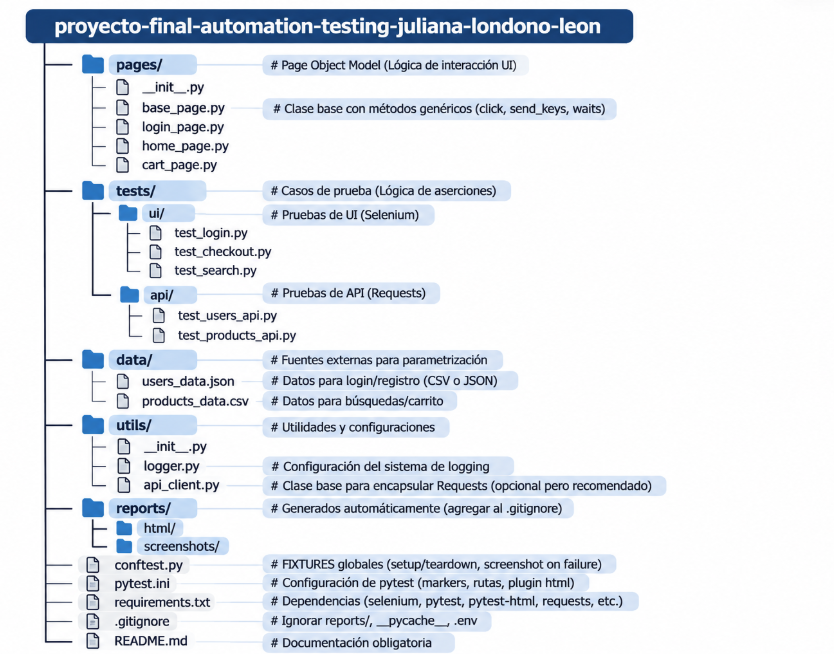
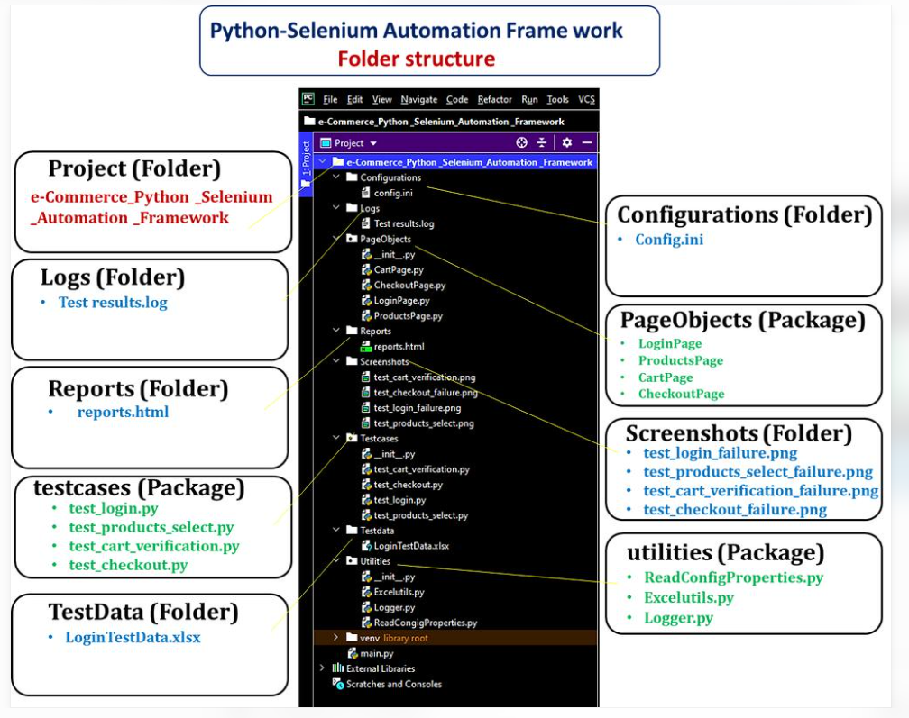

# Framework de Automatización de Pruebas - Proyecto Final

## 1. Propósito del Proyecto

Este repositorio contiene un **framework de automatización de pruebas integral** desarrollado en Python como trabajo final integrador del curso. El objetivo es validar tanto la **interfaz de usuario (UI)** como los **servicios backend (API)** del sitio [Automation Exercise](https://automationexercise.com), asegurando la calidad del software mediante:

- ✅ Pruebas funcionales de UI con flujos completos de e-commerce
- ✅ Pruebas de API cubriendo métodos GET, POST y DELETE
- ✅ Escenarios positivos y negativos
- ✅ Parametrización con datos externos (JSON)
- ✅ Generación automática de reportes HTML y capturas de pantalla
- ✅ Sistema de logging detallado para facilitar la depuración

El framework está diseñado para ser **escalable, mantenible y reutilizable**, aplicando buenas prácticas de la industria como el patrón **Page Object Model (POM)**.

---

## 2. Tecnologías Utilizadas

| Categoría | Tecnología | Versión | Propósito |
|-----------|------------|---------|-----------|
| **Lenguaje** | Python | 3.x | Lenguaje principal del framework |
| **UI Testing** | Selenium WebDriver | 4.15.2 | Automatización de navegador |
| **API Testing** | Requests | 2.31.0 | Consumo de APIs REST |
| **Framework de Tests** | Pytest | 7.4.3 | Ejecución y organización de tests |
| **Reportes** | pytest-html | 4.1.1 | Generación de reportes HTML |
| **WebDriver Manager** | webdriver-manager | 4.0.1 | Gestión automática de drivers |
| **Patrón de Diseño** | Page Object Model (POM) | - | Separación de responsabilidades |
| **Datos Externos** | JSON | - | Parametrización de tests |

---

## 3. Estructura del Proyecto



### Principios de Diseño Aplicados

- **Page Object Model (POM)**: Separación entre la lógica de los tests y la interacción con las páginas.
- **DRY (Don't Repeat Yourself)**: Métodos reutilizables en `BasePage`.
- **Data-Driven Testing**: Parametrización desde archivos JSON externos.
- **Fail-Fast**: Screenshots automáticos solo cuando un test falla.

---

## 4. ¿Cómo Instalar las Dependencias?

### Requisitos Previos
- Python 3.8 o superior instalado ([descargar aquí](https://www.python.org/downloads/))
- Git instalado ([descargar aquí](https://git-scm.com/))
- Google Chrome instalado en tu computadora
- pip install -r requirements.txt

### Pasos de Instalación

**1. Clonar el repositorio:**
```bash
git clone https://github.com/zigguratdigitaldesign-design/proyecto-final-automation-testing-juliana-londono-leon.git
cd proyecto-final-automation-testing-juliana-londono-leon

### ¿Cómo Ejecutar las Pruebas?
pytest
## Ejecutar solo pruebas de UI
pytest -m ui -v
## Ejecutar solo pruebas de API
pytest -m api -v
## Ejecutar un archivo específico
pytest tests/ui/test_login.py -v
## Ejecutar con reporte HTML detallado
pytest --html=reports/html/report.html --self-contained-html

